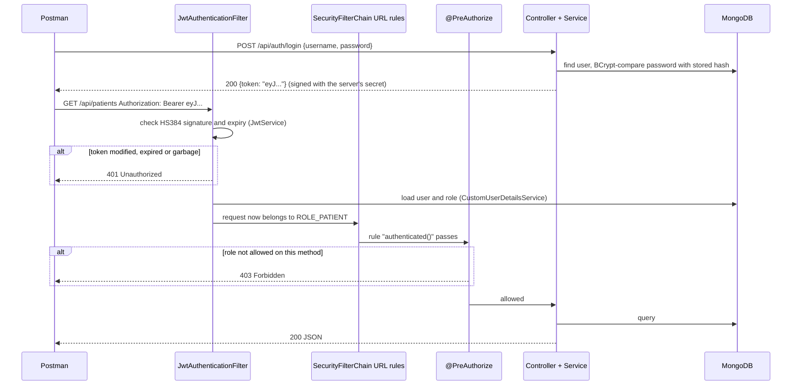

# Hands-on Labs: Learn Spring Security + JWT + MongoDB by Rebuilding This Project

This project is complete and working. The labs take it apart one piece at a time. For each piece you
**read** the concept, **try** it in Postman or the terminal, **rewrite** the real class from a skeleton
full of TODOs, and **check** your code with an automated test that tells you when you got it right.

| Lab | Topic | You write | Checked by |
|-----|-------|-----------|------------|
| 0 | Run it and explore | nothing (explore) | Postman, MongoDB Compass |
| 1 | MongoDB documents and repositories | `PatientService` | `SecurityFlowIntegrationTests` |
| 2 | Password hashing with BCrypt | `PasswordHashingTest`, `CustomUserDetailsService` | `PasswordHashingTest`, `CustomUserDetailsServiceTest` |
| 3 | A JWT by hand, with no libraries | `DecodeJwt.java`, `SignJwt.java` | you run them |
| 4 | Creating and validating JWTs | `JwtService` | `JwtServiceTest` |
| 5 | The JWT authentication filter | `JwtAuthenticationFilter` | `JwtAuthenticationFilterTest` |
| 6 | The SecurityFilterChain | `SecurityConfig` | `SecurityFlowIntegrationTests` |
| 7 | RBAC with `@PreAuthorize` and ownership rules | `PatientController`, `AppointmentService` | `SecurityFlowIntegrationTests` |
| 8 | Attack your own API (Assignment Task 2) | attacks | Postman |
| 9 | Challenges: build new features yourself | anything | tests you write |

Do them in order: each lab builds on the one before. Plan for about 30 to 60 minutes per lab.

---

## How a lab works

Work on your own branch, so the reference solution stays safe in git:

```bash
git switch -c practice
```

**1. Swap the real class for the skeleton.** Each `exercises/labN/src` folder mirrors the project, so
copying it over `src` replaces the real files with TODO versions:

```bash
cp -r exercises/lab4/src .
```

On Windows PowerShell:

```powershell
Copy-Item -Recurse -Force exercises\lab4\src .
```

**2. Run the checker.** It fails before you start.

```bash
./mvnw test -Dtest=JwtServiceTest
```

On Windows PowerShell (the quotes are needed):

```powershell
.\mvnw.cmd test "-Dtest=JwtServiceTest"
```

**3. Complete the TODOs.** Run the checker again until it is green. Read each failing test: its name
says what is expected.

**4. Compare with the reference solution.** `git diff` shows your code next to the original:

```bash
git diff
```

**5. Keep your version**, or throw it away and get the reference back:

```bash
git add -A && git commit -m "Lab 4 done"
```

```bash
git restore src
```

> The tests do **not** need MongoDB installed. They start an in-memory MongoDB-compatible server.
> You need a real MongoDB only to run the app itself (Labs 0 and 8).

---

## The big picture



Remember these three ideas:

1. **Authentication** answers *who are you?* (the login and the JWT). If it fails, the answer is **401**.
2. **Authorization** answers *what may you do?* (roles and ownership). If it fails, the answer is **403**.
3. **Stateless**: the server remembers nothing between requests. The token is the only proof of identity,
   so it must be impossible to forge. That is what the signature is for.

---

## Lab 0: Run it and explore

**Set up.**

1. Install MongoDB Community Server and start it. It listens on `mongodb://localhost:27017`.
   With Docker you can run `docker run -d -p 27017:27017 mongo:8` instead.
2. Start the app with `./mvnw spring-boot:run`, or `mvnw.cmd spring-boot:run` on Windows.
3. In Postman, import `postman/Hospital-Management-System.postman_collection.json` and set the
   collection variable `studentNo` to your student number.

**Explore the data.** Open MongoDB Compass or `mongosh`:

```js
use hospital_db
db.users.find({}, { username: 1, password: 1, role: 1 })   // passwords are BCrypt hashes
db.patients.find()
db.appointments.find()                                      // notice patientId AND patientName
```

**Predict, then send.** For each request below, write down the status code you expect
(200, 201, 401 or 403) *before* you click Send:

| Request | Token |
|---|---|
| `GET /api/patients` | none |
| `GET /api/patients` | patient |
| `GET /api/patients` | doctor |
| `GET /api/admin/patients` | doctor |
| `GET /api/doctors` | patient |
| `GET /api/auth/me` | `Bearer hello` |

<details><summary>Answers</summary>

401 (no token), 403 (patients may not list patients), 200, 403 (`/api/admin/**` is ADMIN only),
200 (any logged-in user may see doctors), 401 (`hello` is not a valid JWT).
</details>

---

## Lab 1: MongoDB documents and repositories

**Learn.**

- MongoDB stores **documents** (JSON-like objects) in **collections**, not rows in tables.
  `@Document(collection = "patients")` maps a Java class to a collection.
- `@Id String id` holds an **ObjectId** such as `6731f0c2a1b2c3d4e5f60718`, which MongoDB generates on insert.
- `@Indexed(unique = true)` on `AppUser.username` makes MongoDB itself refuse duplicate usernames.
- **There are no JOINs and no foreign keys.** An `Appointment` stores `patientId` and `doctorId` so it
  can find them again, and also a *copy* of `patientName` and `doctorName` so a list can be shown with
  one query. Copying data like this is called **denormalisation**.
- **Derived queries.** Spring Data writes the query from the method name:

| Repository method | MongoDB query it runs |
|---|---|
| `findByUsername(u)` | `db.users.find({ username: u })` |
| `findByRoleOrderByFullNameAsc(DOCTOR)` | `db.users.find({ role: "DOCTOR" }).sort({ fullName: 1 })` |
| `findByFullNameContainingIgnoreCase(n)` | `db.patients.find({ fullName: /n/i })` |
| `existsByPatientId(id)` | is there at least one `{ patientId: id }`? |

**Try.** Run `db.patients.find({ fullName: /amaya/i })` in mongosh. Then call
`GET /api/patients?name=amaya` as admin. You get the same result.

**Code.**

```bash
cp -r exercises/lab1/src .
```

Then complete the 3 TODOs in `service/PatientService.java`.

**Check.**

```bash
./mvnw test -Dtest=SecurityFlowIntegrationTests
```

**Think.**

1. A SQL database with a foreign key would refuse to delete a patient who has appointments. Who does
   that job here?
2. A patient changes their name. What happens to `patientName` in their old appointments? Is that a
   bug or a feature?
3. Why does `PatientService.create()` set `id` to `null` before saving?

<details><summary>Answers</summary>

1. Our code does: `delete()` checks `existsByPatientId` and throws 409 Conflict. MongoDB will happily
   leave orphaned references behind.
2. The copies keep the old name, because each one is a snapshot from the time of booking. That is the
   trade-off of denormalisation: faster reads, but copies can become stale. For appointments, a
   historical snapshot is acceptable.
3. `save()` with an existing `id` *overwrites* that document instead of inserting a new one. The JSON `id` is
   already read-only (`@JsonProperty(access = READ_ONLY)`); clearing it again is defence in depth.
</details>

---

## Lab 2: Password hashing with BCrypt

**Learn.**

- Never store passwords. Store a **one-way hash**. At login, hash what the user typed and compare.
- **BCrypt** adds a random **salt**, so two users with the same password get different hashes. That
  defeats precomputed "rainbow tables".
- It is also deliberately **slow** (the cost factor, 2^10 rounds by default), which makes guessing billions of
  passwords expensive.
- Spring Security only knows the `UserDetailsService` interface. `CustomUserDetailsService` translates
  our MongoDB `AppUser` into Spring's `UserDetails`: username, hash, and authorities such as `ROLE_DOCTOR`.

**Code.**

```bash
cp -r exercises/lab2/src .
```

Then:

1. Replace each `fail(...)` in `src/test/.../security/PasswordHashingTest.java` with real assertions.
   This is a "learning test": you discover the behaviour by writing it down.
2. Complete `security/CustomUserDetailsService.java`.

**Check.**

```bash
./mvnw test -Dtest=PasswordHashingTest,CustomUserDetailsServiceTest
```

**Think.**

1. If the salt is random, how does `matches()` know which salt to use?
2. Why is hashing better than *encrypting* passwords?
3. Log in with a wrong password, then with a username that does not exist. Why is the error message
   identical?

<details><summary>Answers</summary>

1. The salt is stored *inside* the hash string (the 22 characters after `$2a$10$`).
2. Encryption can be reversed by anyone who steals the key. A hash cannot be reversed. Even the admin
   cannot see users' passwords.
3. A different message would tell an attacker which usernames exist ("user enumeration").
</details>

---

## Lab 3: A JWT by hand, with no libraries

**Learn.** A JWT is three Base64URL parts joined by dots:

```
eyJhbGciOiJIUzM4NCJ9 . eyJzdWIiOiJQUy8yMDIyLzEyMyIsInJvbGUiOiJQQVRJRU5UIiwi... . pR5zI-q6oabMh2zT...
       header                              payload                                  signature
 {"alg":"HS384"}        {"sub":"PS/2022/123","role":"PATIENT","iat":...,"exp":...}
```

The signature is `HMAC-SHA384(secret, header + "." + payload)`. Only the server knows `secret`.

**Code.** Complete the TODOs in `exercises/lab3/DecodeJwt.java` and `exercises/lab3/SignJwt.java`. These are
standalone programs: Java runs them directly, with no Maven needed.

```bash
java exercises/lab3/DecodeJwt.java <paste a token from /api/auth/login>
```

```bash
java exercises/lab3/SignJwt.java verify <token>
```

**Experiments.**

1. `verify` a real token. It should print **VALID**.
2. Change one letter of the payload part and `verify` again. It prints **INVALID**. That is Assignment Task 2
   in one line.
3. `verify` a real token with a different secret as the third argument. It prints **INVALID**.

**Think.**

1. You read the role without any key. What does that tell you about putting data in a JWT?
2. Can you compute the secret from a token's signature?

<details><summary>Answers</summary>

1. JWTs are **signed, not encrypted**: anyone can read the payload. Never put passwords or private
   data in it.
2. Not directly, because HMAC is one-way. But if the secret is short or guessable, an attacker can try
   candidate secrets offline until one produces the same signature. That is why ours is 48 random bytes.
</details>

Reference solutions are in `exercises/lab3/solution/`.

---

## Lab 4: Creating and validating JWTs (`JwtService`)

**Learn.** JJWT does in two calls what you did by hand in Lab 3:

- `Jwts.builder()...signWith(key, HS384).compact()` creates a signed token.
- `Jwts.parserBuilder().setSigningKey(key).build().parseClaimsJws(token)` recomputes the signature,
  compares it, checks `exp`, and throws if anything is wrong.

**Code.**

```bash
cp -r exercises/lab4/src .
```

Then complete `generateToken` and `parseAndValidate` in `security/JwtService.java`.

**Check.**

```bash
./mvnw test -Dtest=JwtServiceTest
```

Read the test names. They list every attack the parser must stop.

**Think.**

1. Why must the parser use `parseClaimsJws` and not `parseClaimsJwt`?
2. The token contains `role`, but the filter (Lab 5) loads the role from MongoDB. Why keep `role` in the
   token at all?
3. What is a sensible expiry time, and what is the trade-off?

<details><summary>Answers</summary>

1. `Jws` means "a JWT with a signature". `parseClaimsJws` *requires* a valid signature, while
   `parseClaimsJwt` accepts unsigned tokens, which is the `"alg":"none"` attack.
2. For clients: a front-end can read it to show or hide menu items. The server never *trusts* it,
   because it always re-reads the role from the database.
3. Short (minutes to an hour) limits the damage of a stolen token, because there is no way to "log out" a
   stateless JWT before it expires. But users then have to log in again more often. Real systems add refresh tokens.
</details>

---

## Lab 5: The JWT authentication filter

**Learn.** A servlet filter runs on every request *before* any controller. `JwtAuthenticationFilter`:

1. reads `Authorization: Bearer <token>`. If there is none, the request continues as anonymous.
2. calls `jwtService.parseAndValidate` to check the signature and expiry.
3. loads the user from MongoDB.
4. puts an `Authentication` into the `SecurityContextHolder`, which is how Spring knows who is logged in
   for *this request only*.
5. answers **401** at once for a token that is bad.

**Code.**

```bash
cp -r exercises/lab5/src .
```

Then complete `doFilterInternal` in `security/JwtAuthenticationFilter.java`.

**Check.**

```bash
./mvnw test -Dtest=JwtAuthenticationFilterTest
```

When that passes, run the whole flow:

```bash
./mvnw test -Dtest=SecurityFlowIntegrationTests
```

**Think.**

1. A request with a *tampered* token: why answer 401 instead of continuing as anonymous?
2. Why does the filter skip `/api/auth/login`?
3. Why catch `SignatureException` before `JwtException`?

<details><summary>Answers</summary>

1. A bad token is a red flag, possibly an attack, so the client should be told clearly. It also stops
   public endpoints such as `/api/auth/register` from quietly treating an attacker as a normal anonymous user.
2. A user whose old token expired must still be able to log in to get a new one.
3. `SignatureException` *is a* `JwtException`. Java uses the first matching `catch`, so the specific
   one must come first or it never runs.
</details>

---

## Lab 6: The SecurityFilterChain (`SecurityConfig`)

**Learn.**

- `SecurityFilterChain` holds the application-wide rules: which URLs are public, sessions on or off,
  which filters run in which order, and what 401/403 responses look like.
- **Stateless** (`SessionCreationPolicy.STATELESS`) means no `HttpSession` and no `JSESSIONID` cookie.
  Every request proves itself with its token.
- **CSRF** attacks abuse cookies that the browser sends automatically. Our token travels in a header that
  JavaScript must add on purpose, so CSRF protection is not needed and is turned off.

**Code.**

```bash
cp -r exercises/lab6/src .
```

Then complete `securityFilterChain` in `security/SecurityConfig.java`.

**Check.**

```bash
./mvnw test -Dtest=SecurityFlowIntegrationTests
```

All 13 tests fail at first. Even login fails, because CSRF is on. Watch them turn green one TODO at a time.

**Think.**

1. Move `.requestMatchers("/api/admin/**").hasRole("ADMIN")` *after* `.anyRequest().authenticated()`.
   What happens, and why?
2. What would happen if the JWT filter ran *after* the authorization check?

<details><summary>Answers</summary>

1. Spring refuses to start with `Can't configure requestMatchers after anyRequest`. The rules are checked
   top to bottom and the first match wins, so a rule after `anyRequest()` could never be reached.
2. Authorization would see an anonymous user on every request, so every protected URL would answer 401.
</details>

---

## Lab 7: RBAC with `@PreAuthorize` and ownership rules

**Learn.**

- **Role-Based Access Control (RBAC):** `@PreAuthorize("hasAnyRole('ADMIN','RECEPTIONIST')")` on a
  controller method, switched on by `@EnableMethodSecurity`. A wrong role gives **403**.
- **Roles are not enough.** Every doctor has `ROLE_DOCTOR`, but Dr. Perera must not complete Dr. Silva's
  appointment. That needs an **ownership** (object-level) check in the service. Missing it is the number 1 item
  in the *OWASP API Security Top 10*: Broken Object Level Authorization.

**Code.**

```bash
cp -r exercises/lab7/src .
```

Then:

1. Add the missing `@PreAuthorize` annotations in `controller/PatientController.java`. The rules are in
   the class comment.
2. Complete `isOwnedBy` in `service/AppointmentService.java`.

**Check.**

```bash
./mvnw test -Dtest=SecurityFlowIntegrationTests
```

**Think.**

1. `/api/admin/**` is already ADMIN-only in `SecurityConfig`. Why annotate `listForAdmin()` too?
2. A patient calls `GET /api/appointments/{id}` with another patient's appointment id. Which line of code
   stops them?

<details><summary>Answers</summary>

1. Defence in depth. If someone later changes the URL rules or adds a second URL mapping, the method is
   still protected.
2. `AppointmentService.get()` calls `isOwnedBy` and throws `ApiException.forbidden(...)`, which becomes 403.
</details>

---

## Lab 8: Attack your own API (Assignment Task 2)

Start the app, log in as your patient (Postman, folder *1. Auth*), and try each attack. Write down the
status code and message for each one. These become your Task 2 screenshots and answer.

| # | Attack | How | Expected |
|---|--------|-----|----------|
| 1 | Change role PATIENT → ADMIN | jwt.io: edit payload, keep the signature. Register a NURSE with it | 401 Invalid JWT signature |
| 2 | Same token, read data | `GET /api/patients` | 401 |
| 3 | Re-sign with your own secret | jwt.io *JWT Encoder* with any secret | 401 |
| 4 | Remove the signature | header `{"alg":"none"}`, empty third part | 401 malformed/unsupported |
| 5 | Use an expired token | restart with env `JWT_EXPIRATION_MS=60000`, wait 1 minute | 401 expired |
| 6 | **The secret leaks** | `java exercises/lab3/solution/SignJwt.java sign '{"sub":"admin","role":"ADMIN","exp":1999999999}'` then `GET /api/admin/stats` | **200: it works!** |

Attack 6 is the most important lesson. The signature only protects you while the **secret** stays
secret. Anyone who has it can mint an ADMIN token. In a real system you must:

- keep the secret out of source code (here: set the `JWT_SECRET` environment variable),
- make it long and random,
- change it immediately if it leaks. Changing it invalidates every issued token.

**Write the Task 2 answer in your own words.** Explain what the signature covers, why changing the payload
breaks it, why the attacker cannot re-sign it, and what the status codes mean. Then compare with the answer in
`README.md` §4.

---

## Lab 9: Challenges

There is no skeleton here. Write the test first, then the code. Use the existing tests as examples.

1. **Filter by status.** `GET /api/doctors/appointments?status=SCHEDULED`. Add a derived query
   `findByDoctorIdAndStatusOrderByAppointmentTimeAsc`.
2. **Change password.** `PUT /api/auth/password` with `{oldPassword, newPassword}`. Check the old one with
   `passwordEncoder.matches` and store the new one with `passwordEncoder.encode`.
3. **Log out everywhere.** Add `passwordChangedAt` to `AppUser`. In the filter, reject tokens whose `iat`
   is older than that. This is a simple form of token revocation for stateless JWTs.
4. **Account lockout.** Lock an account for 15 minutes after 5 failed logins. Why does this slow attackers down?
5. **Nurse vital signs.** A new `VitalSigns` document (patientId, temperature, pulse, bloodPressure)
   that NURSE and DOCTOR can write and patients can read for themselves only.
6. **Audit log.** Store who did what and when (`AuditEvent` collection) for every DELETE.
7. **Refresh tokens.** Issue a short-lived access token (5 min) plus a long-lived refresh token stored in
   MongoDB, and add `POST /api/auth/refresh`.

---

## Quick self-test

Answer without looking. Each answer is somewhere in the labs above.

1. What is the difference between 401 and 403?
2. Is a JWT payload encrypted?
3. What exactly does the signature protect, and with what?
4. Why does BCrypt add a salt? Why is it slow on purpose?
5. What does "stateless" mean, and why does it make JWT expiry important?
6. What is the difference between a role check and an ownership check?
7. Why is CSRF protection disabled in this API?
8. Why must the JWT filter run before the authorization rules?
9. MongoDB has no foreign keys. Where is "do not delete a patient with appointments" enforced?
10. What happens if `app.jwt.secret` is pushed to a public GitHub repository?
